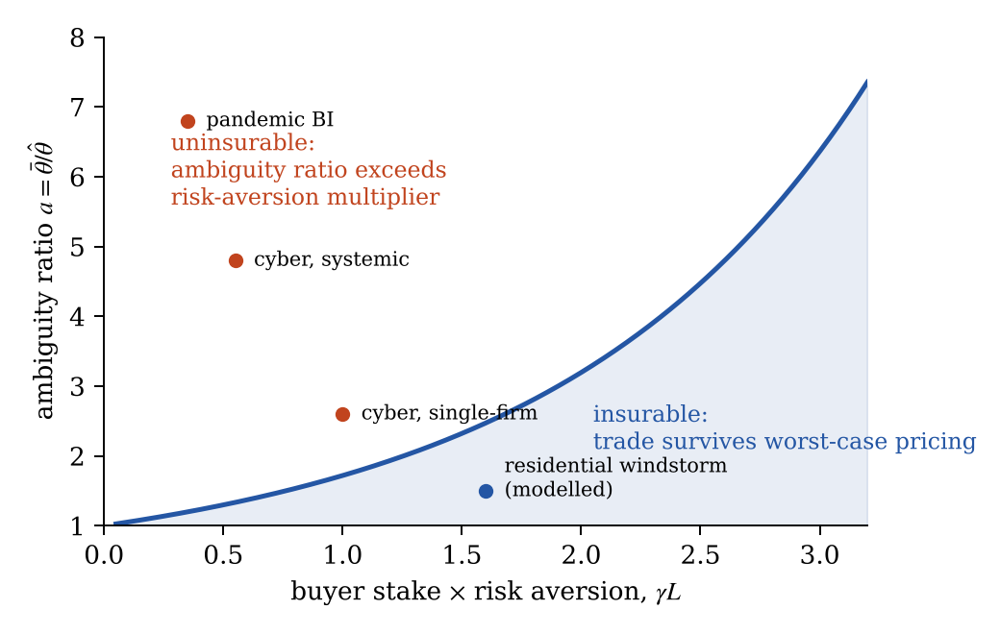

# The Insurability Frontier

Code for the numerical checks and figures of

> Aslan, I. (2026). The insurability frontier: Ambiguity, capital, and the supply of insurance. Working paper. [SSRN 7198564](https://ssrn.com/abstract=7198564)



High layers of catastrophe reinsurance trade at large multiples of expected loss, cyber cover repriced by more than one hundred per cent year-on-year at the height of the ransomware surge, and pandemic business interruption found no private price at all. The paper traces these patterns to one mechanism: model uncertainty, unlike sampling risk, is common to every policy in a book and cannot be pooled away. In a smooth-ambiguity model of an insurer, the per-policy ambiguity load rises with book size and converges to the worst-case price over the insurer's set of loss models. Combined with demand anchored on best-estimate probabilities, this gives a closed-form insurability frontier. Cover exists only where the ratio of worst-case to best-estimate loss probability lies below a risk-aversion multiplier.

## Main results

- **Convergence to the worst case (Figure 1).** With a second-order prior of mean 0.01 on [0, 0.05], the reservation premium per unit of cover rises from 0.010 at small scale to 0.031 at a scale of 1,000 and 0.049 at 100,000, approaching the worst case of 0.05. A wider prior with the same mean raises the load at every scale.
- **The frontier (Figure 2).** The risk-aversion multiplier m(γL) = (e^γL − 1)/γL is 1.3 at γL = 0.5, 1.7 at γL = 1, 3.2 at γL = 2 and 6.4 at γL = 3.
- **Premium multiples (Table 1).** Through the capital channel, with θ̂ = 0.01 and a frictional capital cost of 0.05, 0.07 and 0.10, the price is 5.7, 7.5 and 10.0 times the expected loss.
- **Price path (Figure 3).** A surprise that moves the market convention from (m, w) = (0.015, 0.005) to (0.025, 0.030) raises the price by about 39 per cent on impact. Single-digit annual softening follows (−7.0, −3.3, −2.1 per cent, …) as confirming data narrow the model set.

## Files

| File | Content |
|---|---|
| `checks.py` | Symbolic and numerical checks of the closed forms and every number quoted in the paper |
| `figures.py` | Figures 1 to 3 |
| `results/checks.txt` | Output of `checks.py` |
| `results/fig1_load.png`, `.pdf` | Figure 1: reservation premium per policy against book scale, two second-order priors |
| `results/fig2_frontier.png`, `.pdf` | Figure 2: the insurability frontier |
| `results/fig3_path.png`, `.pdf` | Figure 3: price path after a surprise loss |

## Running the code

```
python -m pip install -r requirements.txt
python checks.py > results/checks.txt
python figures.py
```

Both scripts run in a few seconds; the calculations are deterministic. They were last checked with Python 3.13, NumPy 2.5, SciPy 1.18, SymPy 1.14 and Matplotlib 3.11.

## Citation

Please cite the paper. GitHub's "Cite this repository" button gives the reference in APA and BibTeX formats.

## Licence

MIT licence (see `LICENSE`).

## Author

Ilker Aslan, Lecturer, Kalaidos University of Applied Sciences, Zürich
[ORCID 0000-0001-9241-9420](https://orcid.org/0000-0001-9241-9420) · [ilkeraslan.github.io](https://ilkeraslan.github.io)
